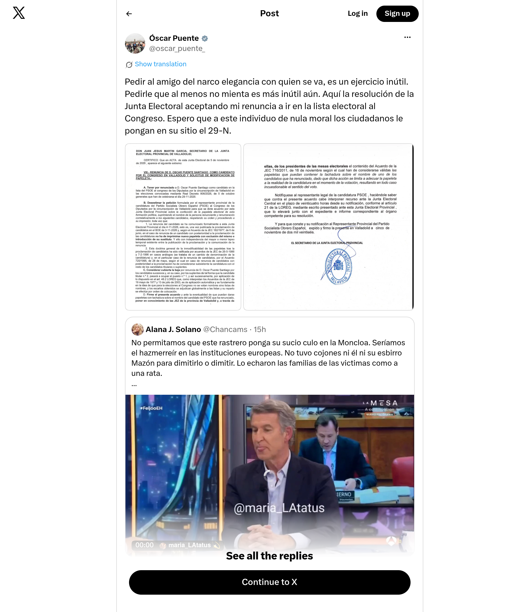

# Captura archivada de X — @oscar_puente_

[Ver imagen original](./screenshot.png) · [Metadatos completos](./metadata.json)

| Dato | Valor |
|---|---|
| Publicación original | https://x.com/oscar_puente_/status/2120864198519357712 |
| Autor | @oscar_puente_ |
| Publicación del tuit (UTC) | 2026-11-12T13:00:03Z |
| Solicitud de captura (UTC) | 2026-11-12T13:31:01Z |
| Imagen guardada localmente (UTC) | 2026-11-12T13:31:11Z |
| Ficha preparada (UTC) | 2026-11-12T13:32:02Z |
| Archivo | `screenshot.png` |
| Dimensiones | 2000 × 2400 px |

## Método

Pantallazo automático de la página original de X mediante Microlink Screenshot API. La imagen PNG se descargó y se conserva sin edición ni recompresión posterior. La configuración completa está en `metadata.json`.

Se solicitó una pantalla de 1000 × 1200 píxeles CSS, renderizado de JavaScript y una espera de tres segundos. Se ocultaron las capas de ventanas emergentes de X para evitar que tapasen el contenido.

Puede incluir publicaciones y respuestas cercanas. El contenido fuera del encuadre queda excluido; los vídeos aparecen como imágenes estáticas. Microlink puede servir imágenes de caché: la hora exacta de renderizado del proveedor es desconocida. Las fechas anteriores describen la solicitud y el guardado en nuestro sistema.

Recurso devuelto por Microlink: [PNG](https://iad.microlink.io/2E5vZUYF_EHpG5r6gjQ-6ya7T3Lgcmi74PjIPEDuPGS-ne0k-avy4RjLUIwjpGh_oAbjXgU8oqsIt-UGfvVtpg.png)

## Integridad

SHA-256 (`screenshot.png`):

`13fa2558b5c1ed150fe02da590715743a72dfed1fafcfb2ed2b27d012592fc3e`

La huella permite comprobar que una copia coincide con esta imagen; no certifica de forma independiente la hora de captura. Cada nueva captura se almacena en una carpeta distinta. La primera incorporación de esta carpeta queda registrada en el historial de commits de GitHub.
